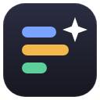
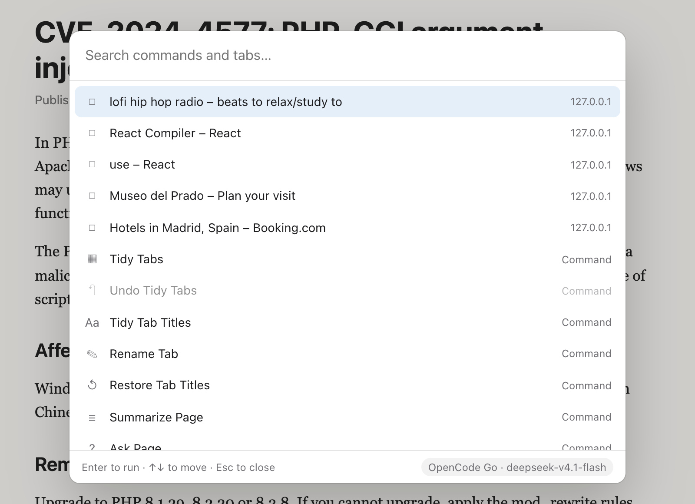
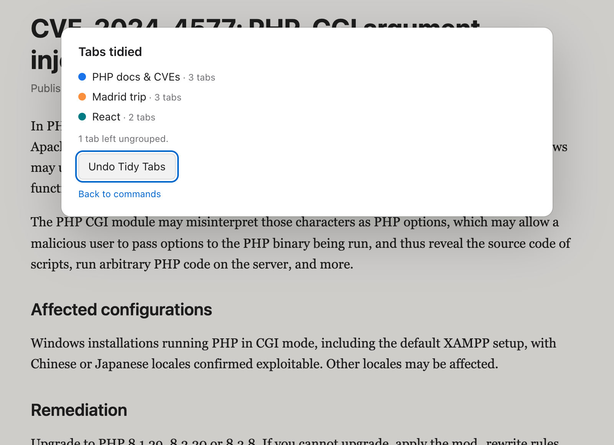
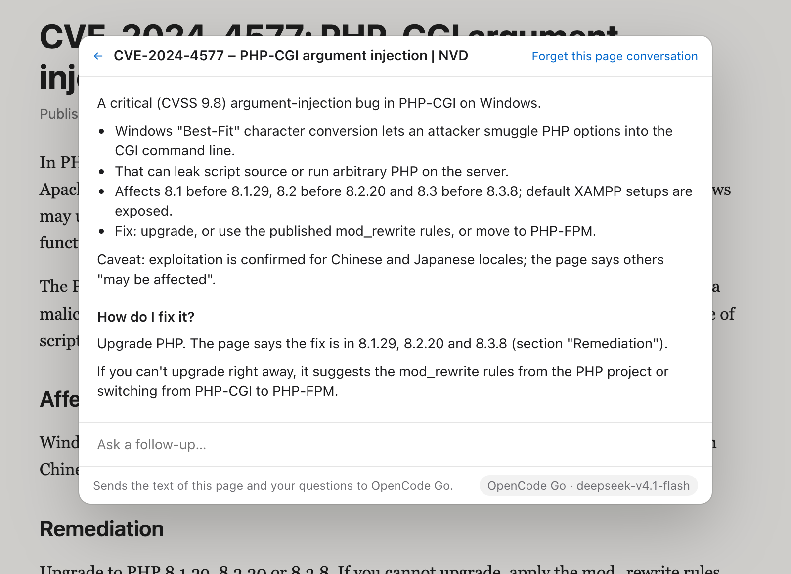
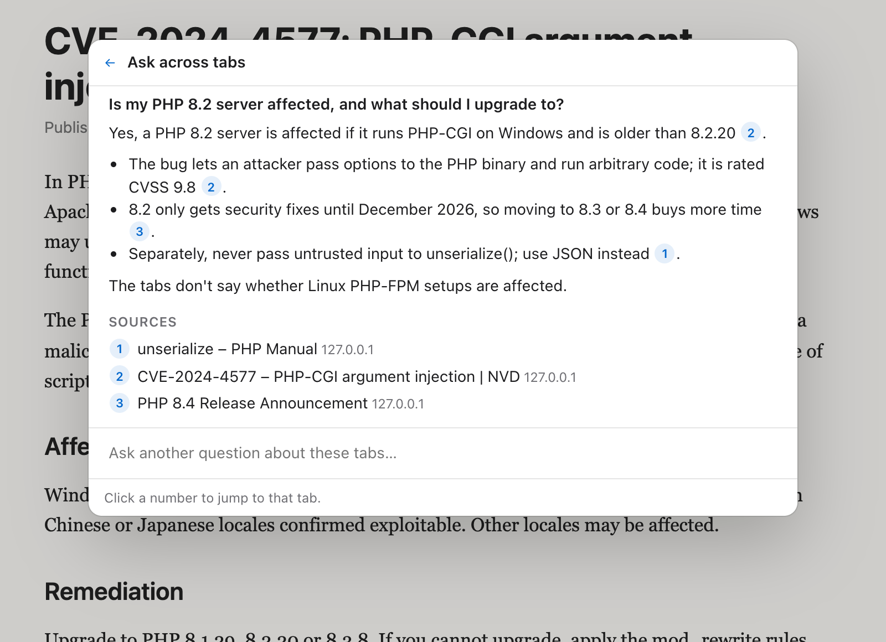
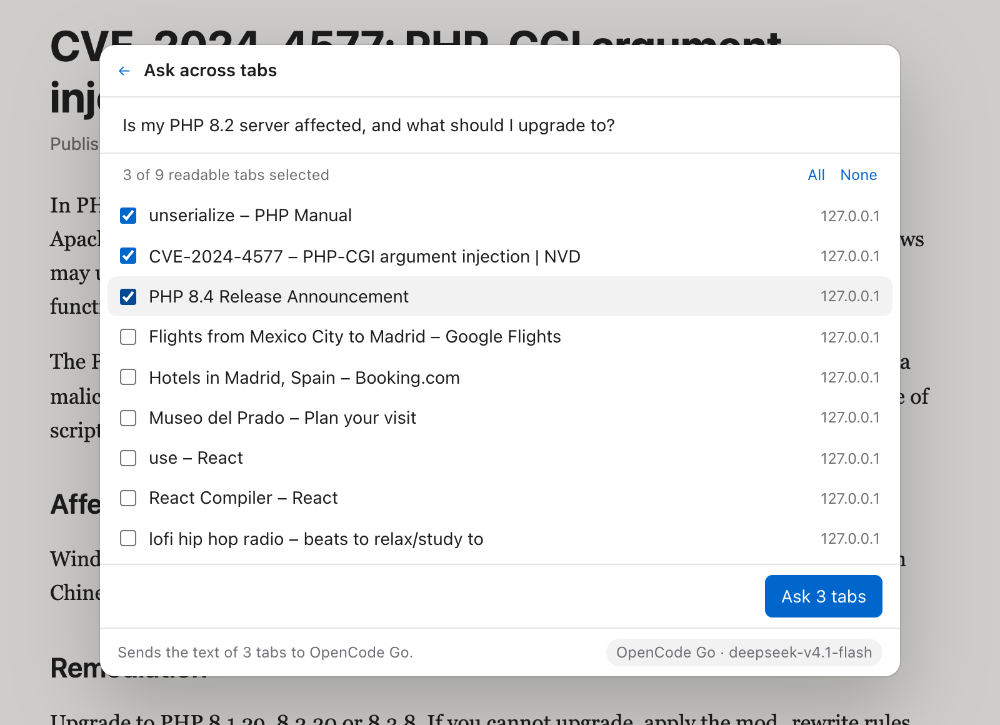
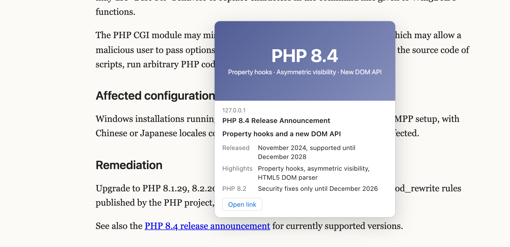
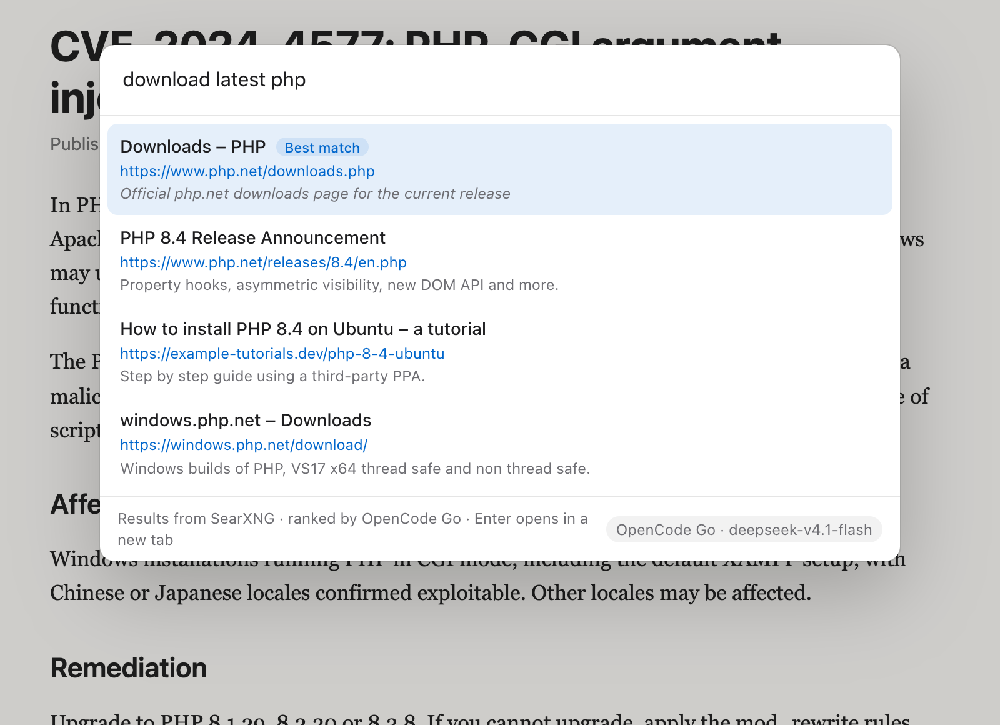
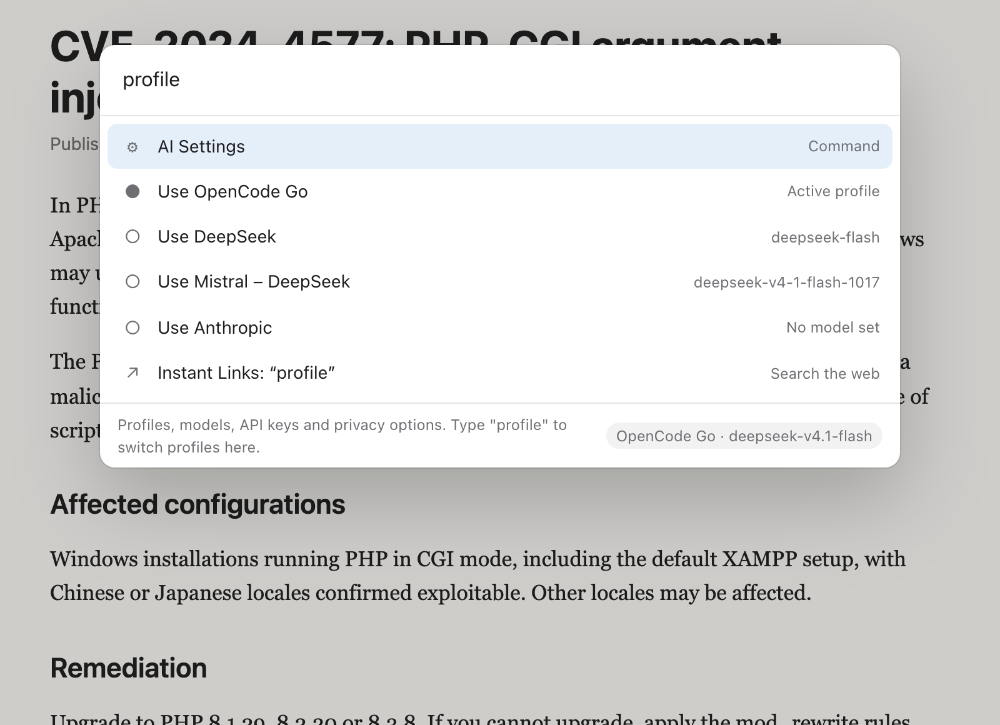
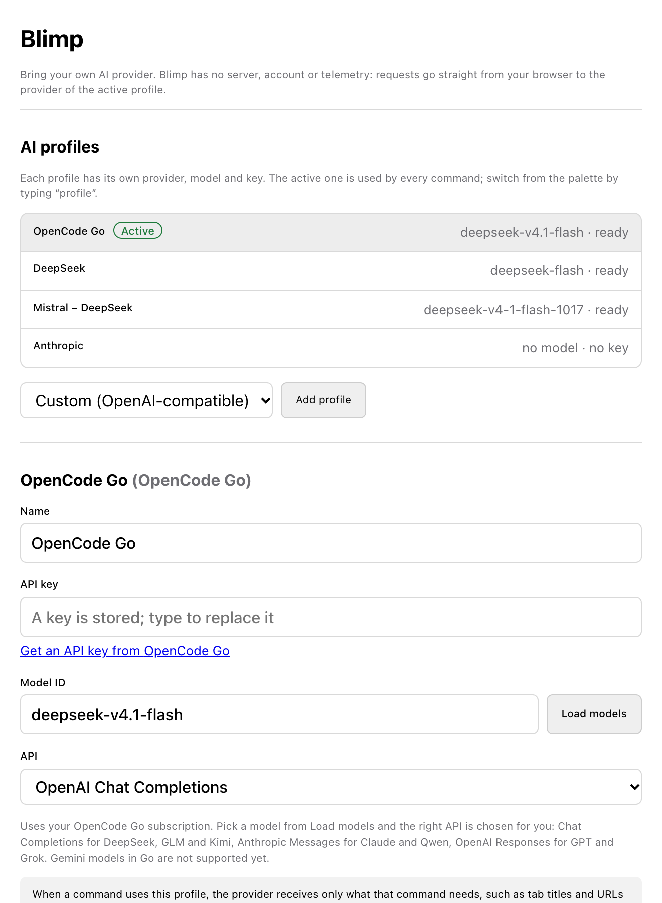

<p align="center">
  
</p>

<h1 align="center">Blimp</h1>

<p align="center">
  The Arc features I missed, rebuilt as one extension for <a href="https://helium.computer/">Helium</a>.<br>
  ⌘K palette · Tidy Tabs · ask a page or a whole window of tabs · Shift-hover previews · your own AI key
</p>

<p align="center">
  <a href="https://github.com/RobertoVillegas/blimp/releases/latest"><strong>Download the latest build</strong></a>
  ·
  <a href="docs/PRD.md">Product spec</a>
  ·
  <a href="docs/compatibility.md">Compatibility notes</a>
</p>

<p align="center">
  <picture>
    <source media="(prefers-color-scheme: dark)" srcset="docs/images/palette-dark.png">
    
  </picture>
</p>

When I moved from Arc to Helium, the part I kept reaching for was Arc Max: tidy my tabs, tell me what this page says, let me do it from the keyboard. Blimp puts those back as one Manifest V3 extension.

There's no Blimp server and no account. Requests go from your browser straight to the AI provider you configure, with your key, and only when you run a command.

Blimp was called Helium Max until v0.6. Not affiliated with Helium or The Browser Company.

## What it does

### ⌘K palette

Press ⌘K on any page to search commands and your open tabs, or copy the page's URL, a Markdown link, or the selected text as a quote with a link back. Type part of a tab's title and press Enter to jump to it. Searching never calls the AI. If Helium keeps ⌘K for itself, use ⇧⌘K or the toolbar button. On pages extensions can't touch, like `helium://` pages and the Web Store, the palette opens as a popup instead.

### Now playing

When something plays in any tab, the palette shows it at the top, like Arc's mini player: title and artist, play/pause, previous/next on YouTube, YouTube Music, Spotify and SoundCloud, mute, go to tab, and picture in picture for the video on the page you're on. **Play or Pause Media** does it from the keyboard. Mute and go-to-tab work everywhere; playback controls need access to the site, and the card asks the first time.

### Live Folders

Like Arc's: folders that keep themselves up to date, in **⌘K › Live Folders**. Follow GitHub pull requests waiting for your review, your own PRs, what's assigned to you or any GitHub search (with a read-only token), or any RSS or Atom feed: blogs, YouTube channels, a repository's releases. They refresh every 30 minutes; new items get a dot, and you can open them all at once or mark them read. Set them up in Settings › Live Folders.

### Auto-archive and Capture

**Auto-archive** (off by default, Settings › Auto-archive) closes tabs you haven't used in 12 hours, a day, a week or a month, like Arc. Pinned tabs, tabs in groups, the tab you're on and tabs playing sound are never touched. Archived tabs wait in **⌘K › Archived Tabs** for 30 days; Enter reopens one.

**Capture**: in ⌘K, run Capture, then drag over part of the page (or press Enter for everything you see). The image goes to the clipboard, with a Save button to keep it as a file.

### Little Blimp

Arc's Little Arc. Press **⌥⇧N** (or run **New Little Blimp** in the palette) for a small window without a tab strip: type a search or an address and go. To keep the page, open the palette there and run **Open in Main Window**; it moves into your main window as it is, scroll position and anything you typed included. Right-click any link › **Open Link in Little Blimp** to look at it on the side. Little Blimp remembers where you put it and how big you made it. (Arc used ⌥⌘N; Chromium doesn't let extensions take ⌘+⌥ shortcuts. You can pick another key at `chrome://extensions/shortcuts`.)

### Peeks: Gmail and Calendar

**Unread Email** shows your unread Gmail (sender, subject, snippet) and opens a message in your Gmail tab; **Upcoming Events** shows today and tomorrow from your Google Calendar with a Join button for Meet, Zoom or Teams links. Turn them on in Settings › Peeks: Gmail uses the account you're signed in to in this browser, and Calendar uses the calendar's secret iCal address, kept like an API key. Nothing from either goes to an AI.

### Picture in Picture

On a page with a video, open the palette and run **Picture in Picture**: the video floats in its own window that you can drag anywhere and park in a corner. Run it again to bring it back. It picks the video that's playing, or the biggest one on the page. Videos inside embedded players (iframes) aren't reachable yet.

To float videos automatically when you switch tabs, as Arc did, turn on **Float a playing video when I switch to another tab** in Settings › Video (experimental). The browser does the floating and may ask once per site.

### Tidy Tabs



Run **Tidy Tabs** and the model reads your tab titles and URLs. It invents group names that fit what you have open, like "PHP docs & CVEs" or "Madrid trip", and Blimp turns them into real tab groups.

- It only runs when you ask. Never on a timer, never when a tab opens.
- Pinned tabs and groups you made yourself are left alone. If you'd like new tabs to join your existing groups instead (a new PHP tab into your "PHP" group), turn on **Also add tabs to groups I already have** in Settings. Your groups keep their names and colors, and Undo takes the added tabs back out.
- Tabs that don't fit anywhere stay ungrouped. There's no "Misc" group.
- It names groups. It doesn't rename, close or discard tabs; renaming is a separate command (below).
- If the model returns anything that doesn't match your real tabs, nothing changes.
- **Undo Tidy Tabs** puts every tab back where it was and tells you about tabs that moved in the meantime.

<br clear="right">

### Summarize and Ask Page



**Summarize Page** gives you the gist of the article you're on. **Ask Page** answers questions from it, and you can keep asking follow-ups. Answers quote the page word for word; each quote is checked against the page, flagged if it isn't really there, and **Show on page** jumps to it. The model is told to say when the page doesn't contain the answer instead of guessing.

It only reads text you can see in the article. It skips menus, footers, hidden elements and forms, and it never reads password fields or what you typed into a form. Press **Forget this page conversation** to drop it, or quit the browser.

<br clear="right">

### Ask AI and Browse for Me

Type anything in the palette and press **Tab** to **Ask AI**, like Arc's ChatGPT in the command bar, with follow-ups. **Browse for Me** searches with your search provider, reads the top results and answers with numbered sources you can click; sites Blimp can't read yet count only by their search snippet, and it offers to allow them.

### Ask across tabs



**Summarize Tabs** and **Ask Across Tabs** work over several tabs at once. You pick the tabs first; nothing is read until you press the button. The answer puts a numbered chip after each claim, and clicking a number takes you to that tab.

Tabs that can't be read are listed under **Skipped** with the reason: browser pages, sites you haven't given access to, and sleeping tabs unless you tick **Wake sleeping tabs**, which loads them in the background without switching to them. When there's more text than fits in one request, it summarizes in batches first and then combines them, with a cap so a big window can't run up your bill.

<details>
<summary>Picking the tabs</summary>
<br>

</details>

<br clear="right">

### Shift-hover link previews



Hold Shift over a link and a card tells you what's on the other side, without opening a tab: a short headline and a few labeled facts, like Arc's answer card. Optionally, on Hacker News, Google results, Reddit, X, GitHub and Lobsters, resting on a story or result link for a second previews it without Shift. This is off until you turn it on in Settings, because it needs access to the sites you visit.

The linked page is downloaded without your cookies, so anything behind a sign-in shows as unavailable instead of a made-up summary. Hovering without Shift sends nothing, and holding Shift while you type in a field doesn't trigger it either.

<br clear="right">

### Instant Links



Type what you want, like "download latest php", "directions from the Zócalo to Coyoacán" or "lofi beats on YouTube", then pick **Instant Links** (or the "Instant Links: …" row at the bottom of the palette). It works out whether you want one site or a list, and handles images, news, maps, directions, flights and searching inside a site; asking for several results gives you an "Open top 3" button. The results come from a real search engine, [Brave Search API](https://brave.com/search/api/) or your own [SearXNG](https://docs.searxng.org/), and the AI only picks the best match. Every URL is shown before you open it, and the extension refuses to open anything that wasn't in the results.

With no search provider set up, it hands the query to your browser's normal search engine instead of guessing a URL.

<br clear="right">

### Tidy Downloads

Off by default. When it's on, each download gets a clearer name before it's saved: `inv_8812.pdf` becomes `Acme invoice 8812.pdf`. The extension never changes, the file's contents are never read, and if the AI takes more than 4 seconds the browser's own name is used. Files you already downloaded are left alone.

### Tab names

**Tidy Tab Titles** gives your pinned tabs short names, the way Arc did: "Inbox (3) - you@gmail.com - Gmail" becomes "(3) Mail" and "Hooks reference – React" becomes "React Hooks". You see every proposed name first, can edit or skip any of them, and nothing changes until you press Rename. **Rename Tab** names any tab yourself. **Restore Tab Titles** puts the sites' titles back.

Names stick when the site rewrites its title (unread counts keep updating in front of the name) and after reloads and restarts, as long as Blimp has access to that site; it asks the first time. Under the hood the extension sets the page's title, since browsers don't let extensions edit the tab strip directly.

### AI profiles



Each profile is a provider plus a model plus a key. On first run you get one for OpenAI, Anthropic, Gemini, DeepSeek, Mistral and OpenCode Go, so you only paste a key. Add as many more as you like, for example two Mistral profiles pointing at different models.

Type `profile` in the palette to switch which one is active. Under **Models per feature** in Settings you can also give a feature its own profile, say a fast, cheap model for link previews and filenames and a stronger one for answers across tabs.

<br clear="right">

## Install

You don't need Node to try it.

1. Download `blimp-<version>-chrome.zip` from the [latest release](https://github.com/RobertoVillegas/blimp/releases/latest) and unzip it somewhere you'll keep it. Helium loads the extension from that folder, so don't delete it.
2. In Helium, open `helium://extensions` (`chrome://extensions` also works) and turn on **Developer mode**.
3. Click **Load unpacked** and pick the unzipped folder, the one with `manifest.json` in it.
4. Settings opens by itself. Pick a profile, paste your key, then:
   - **Load models** to see which model IDs your key can use, and pick one.
   - **Save and use**. Helium asks to let the extension reach that provider's API; allow it.
   - **Test connection**. You should get "Connected".
5. Open any article and press ⌘K.
6. Optional, further down in Settings: turn on **Link previews** and **Tidy Downloads**, and set up a search provider for **Instant Links**.

<details>
<summary>What Settings looks like</summary>
<br>

</details>

### Updating

An extension loaded from a folder can't update itself, so Blimp tells you when there's a new release: a ↑ on the toolbar icon, a notice at the top of the palette, and steps in Settings › Updates. It checks this project's GitHub releases twice a day; you can turn that off in Settings.

1. Download [blimp-chrome.zip](https://github.com/RobertoVillegas/blimp/releases/latest/download/blimp-chrome.zip) (always the newest).
2. Unzip it and copy everything into your Blimp folder, replacing the old files.
3. Blimp notices the new version and reloads itself within a minute, or press **Reload Blimp** in Settings › Updates.

Profiles and settings stay. Keys you kept only for the session need to be entered again. Keep **Developer mode** on: with it off, Helium disables folder extensions when they reload.

> [!NOTE]
> Keys are kept only until you quit the browser, unless you choose **On this device across restarts** in Settings. That option stores them unencrypted in the extension's own storage, which webpages can't read but anyone with your browser profile on disk can.

## Providers

| Profile | Base URL | Notes |
| --- | --- | --- |
| OpenAI | `api.openai.com/v1` | |
| Anthropic | `api.anthropic.com/v1` | |
| Google Gemini | `generativelanguage.googleapis.com/v1beta` | |
| DeepSeek | `api.deepseek.com` | |
| Mistral AI | `api.mistral.ai/v1` | Mistral also hosts DeepSeek and other third-party models. **Load models** shows the IDs your key can use. |
| OpenCode Go | `opencode.ai/zen/go/v1` | Your Go subscription key. Pick a model from **Load models** and the right API is set for you: Chat Completions (DeepSeek, GLM, Kimi, MiMo), Anthropic Messages (Claude, Qwen, MiniMax) or OpenAI Responses (GPT, Grok). Gemini models in Go aren't supported yet. To use DeepSeek there, enable the **Global** region in your OpenCode workspace privacy settings. |
| OpenRouter | `openrouter.ai/api/v1` | Add it with **Add profile**. |
| Ollama | `localhost:11434` | Runs on your machine. Start it with `OLLAMA_ORIGINS="chrome-extension://*" ollama serve`. |
| Custom | anything | Any server that speaks OpenAI Chat Completions, OpenAI Responses or Anthropic Messages; pick which under **API**. |

If a model rejects a setting (newer OpenAI and other reasoning models refuse `temperature`, some servers refuse JSON mode), Blimp retries once without it.

## Keyboard

| Keys | Does |
| --- | --- |
| ⌘K | Open or close the palette |
| ⇧⌘K | Same, for when ⌘K is taken |
| ⌥⇧N | New Little Blimp window |
| ↑ ↓ | Move through results |
| Enter | Run the command or switch to the tab |
| Esc | Back, then close |

Change them, or bind Tidy Tabs to its own shortcut, at `chrome://extensions/shortcuts`.

## What gets sent, and when

| You run | The provider of the profile that feature uses receives |
| --- | --- |
| Searching in the palette | Nothing |
| Tidy Tabs | Titles and URLs of the ungrouped, unpinned tabs in the window |
| Tidy Tab Titles | Titles and URLs of the pinned tabs in the window (Rename Tab sends nothing) |
| Summarize Page, Ask Page | Visible text of the current page, and your questions |
| Summarize Tabs, Ask Across Tabs | Visible text of the tabs you tick, and your question |
| Shift-hover a link (if turned on) | Text of the linked page, downloaded without your cookies |
| Instant Links | Your query goes to the AI to work out what you want and to the search provider; the results go to the AI to pick the best |
| Ask AI | Your question and follow-ups |
| Browse for Me | Your search goes to the search provider; the top results' text goes to the AI |
| A download starts (if Tidy Downloads is on) | Filename, file type, the address without query strings, and the page title |
| Unread Email, Upcoming Events | Nothing to an AI; Gmail's feed is read with your browser session, the calendar from its iCal address |
| Capture | Nothing; the image stays on your clipboard or disk |
| Live Folders | GitHub gets your searches with your token; feeds are fetched without cookies. Nothing goes to an AI |
| Just browsing | Nothing |
| Twice a day (unless turned off) | GitHub's public API is asked for this repository's releases; nothing about you is sent |

The palette footer tells you which provider a command will use before you run it. Blimp asks for no site access when you install it. The palette gets into a page only after you press the shortcut or the toolbar button. Everything else is asked for when you use it: an API origin when you save a profile, a site when you include one of its tabs, all sites only if you turn on link previews, and the downloads permission only for Tidy Downloads.

Previews never fetch local addresses (`localhost`, `192.168.x.x`, `*.local`, Tailscale's `100.64.0.0/10` and so on), so a webpage can't use the extension to poke at your network.

## Status

This is an early build. It loads and runs in Helium; everything below is tested end to end in Chromium against a mock provider. The Helium checklist is in [`docs/compatibility.md`](docs/compatibility.md). The provider adapters are unit-tested against each API's request format but haven't been run against every real provider.

| | Feature | |
| --- | --- | --- |
| ✅ | ⌘K command palette | M1 |
| ✅ | Tidy Tabs with Undo | M1 |
| ✅ | AI profiles (bring your own key) | M1 |
| ✅ | Summarize and Ask Page | M1 |
| ✅ | Shift-hover link previews | M2 |
| ✅ | Summarize and ask across tabs, with sources | M2 |
| ✅ | Instant Links (search results you can open in one step) | M3 |
| ✅ | Tidy Downloads (better filenames, opt-in) | M3 |
| ✅ | Update notice, reloads itself after you copy a new build in | v0.3 |
| ✅ | Tidy into existing groups, wake sleeping tabs, a model per feature | v0.3 |
| ✅ | OpenCode Go models on Anthropic Messages and OpenAI Responses | v0.3 |
| ✅ | Tidy Tab Titles, Rename Tab | v0.3.5 |
| ✅ | Picture in Picture from the palette | v0.3.8 |
| ✅ | Now playing controls in the palette | v0.3.9 |
| ✅ | Gmail and Calendar peeks, auto-float videos (experimental) | v0.4.0 |
| ✅ | Arc Max complete: Ask AI, Browse for Me, verified quotes, answer-card previews, Instant Links intents, copy commands | v0.5.0 |
| ✅ | Little Blimp (Little Arc) | v0.7.0 |
| ✅ | Auto-archive and Capture | v0.8.0 |
| ✅ | Live Folders | v0.9.0 |

The full checklist of Arc features, what's done and what's next, is in [`docs/arc-features.md`](docs/arc-features.md).

[Jev](docs/jev.md), TypeSafe's decision model, was looked at and parked for now.

## Development

See [CONTRIBUTING.md](CONTRIBUTING.md) for how the code is organized, and [SECURITY.md](SECURITY.md) for the threat model and how to report a vulnerability.

```sh
pnpm install
pnpm dev           # watch mode in a throwaway Chromium profile
pnpm check         # typecheck, unit tests, production build
pnpm test:e2e      # loads the extension in Playwright Chromium against a mock provider
pnpm screenshots   # regenerates the images in this README
pnpm zip           # .output/blimp-<version>-chrome.zip
```

Pushing a `v*` tag that matches `package.json` builds the zip and attaches it to a GitHub release.

Built with [WXT](https://wxt.dev), React and TypeScript. The background service worker owns every privileged call: tabs, groups, page reading and provider requests. The palette is a React app that runs either inside a shadow root on the page or as an extension popup, and talks to the worker through typed messages.

```text
src/
  entrypoints/        background worker, palette overlay, hover script, palette popup, settings, grant page
  background/         message router, palette opener (overlay or popup)
  features/
    tidy-tabs/        prompt, plan validation, apply, snapshot and undo
    ask-page/         in-page text extraction, grounded Q&A
    cross-tab/        tab picking, batching, cited synthesis
    link-preview/     private-network guard, capped fetch, cache, hover script registration
    instant-links/    Brave and SearXNG adapters, ranking, open-only-real-results
    tidy-downloads/   safe filenames, onDeterminingFilename with a 4 s deadline
  ai/                 provider presets, wire adapters, model lists, errors
  storage/            settings and profiles, per-profile keys
  ui/palette/         the palette, shared by the overlay and the popup
  shared/             message contracts, types, URL guards, citations
e2e/                  Playwright tests and the README screenshot script
```
