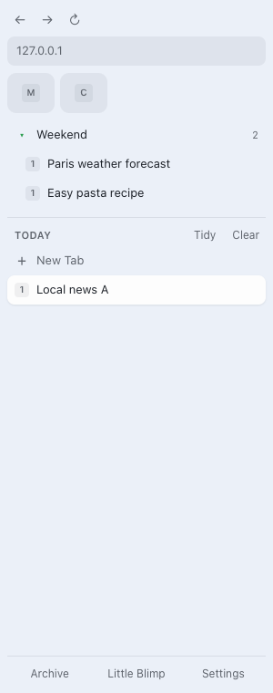
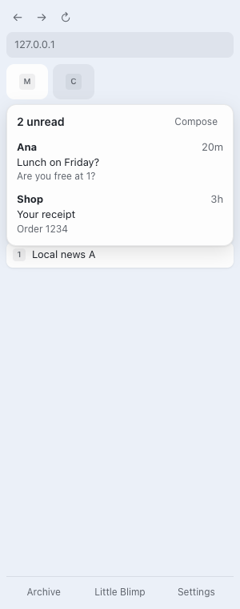
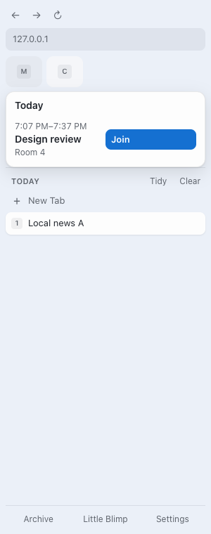

# Exploration: an Arc-style sidebar of our own

Branch `explore/sidebar`. A side panel that puts Blimp's features in one Arc-like column, to decide whether it's worth shipping.

  

## What it does

| Arc | Blimp sidebar | Built on |
| --- | --- | --- |
| Favorites grid | Pinned tabs as icon tiles | `tabs` (pinned) |
| Gmail / Calendar hover cards on favorites | Hovering a pinned Gmail or Calendar tile shows unread mail (with Compose) or upcoming events (with Join) | The existing peeks |
| Pinned folders | Tab groups as collapsible folders, in their color. Collapsing one collapses the group | `tabGroups` |
| Today, with Clear | Ungrouped tabs; **Clear** archives them; **Tidy** groups them with your AI | Archive, Tidy Tabs |
| Drag and drop | Drag a tab between Today, a folder and Favorites (pins, groups or ungroups it) | `tabs.move/group/ungroup` |
| URL bar / Command bar | The address pill opens ⌘K over the page; back, forward, reload above it | Palette |
| Mini player | What's playing, with play/pause/skip | Media |
| Live Folders, Archive, Little Arc | Sections and footer buttons | Existing features |

Open it with **⇧⌘S** or by right-clicking the toolbar icon › **Open sidebar**. Two e2e tests cover the hover cards, folders, drag and drop, Clear and Archive (`e2e/sidebar.spec.ts`).

## What an extension can't do (try these in Helium)

- **It's a second column.** Chromium won't let an extension hide Helium's own tab list or tab strip. For it to feel like Arc, you'd switch Helium to horizontal tabs and live with the strip at the top.
- **Which side it sits on** is Helium's side panel setting, not ours. Chrome has "Show side panel on the left/right"; check whether Helium keeps it.
- **Opening it needs a key press or click** (⇧⌘S, the toolbar menu). It can't open itself when the browser starts. Once open, it should stay open as you switch tabs in that window.
- **No Spaces yet.** Options: one window per Space (tabs stay alive, closest to Arc), or saved tab sets that close and reopen on switch (what arc-like-chrome-extension does). The window approach looks better.
- **No dragging between the sidebar and the tab strip**, no split view, no peeking at links inside the sidebar.

## Decide after a few days of use

1. Does the second column (with horizontal tabs on) feel better than Helium's own vertical tabs + ⌘K?
2. Are the Gmail/Calendar hover cards worth having the column open?
3. If yes: Spaces as windows next, then keyboard navigation in the list and a context menu per tab (rename, duplicate, move to Little Blimp).
